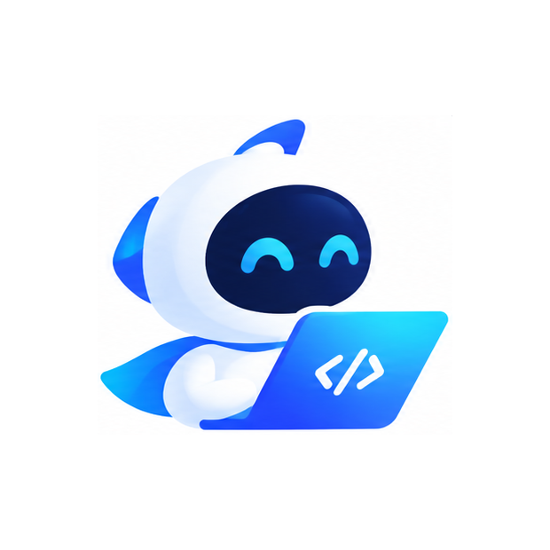

  
  <h1 align="center">AiCodeR (许愿码)</h1>
  

    Community-enhanced fork of <a href="https://github.com/jieapi/AiCode">AiCode</a> · AI coding agent for Android
     
    Same foundation, rebuilt to work unattended: multiple engines, permissioned autonomy, verified on device
     
    <a href="README.md">中文</a> · <a href="README.en.md">English</a>
  

  
  
  

---

## What this is

AiCodeR is a community-enhanced fork of [AiCode](https://github.com/jieapi/AiCode). The upstream project already ships a complete AI coding foundation on Android — Linux container, terminal and editor, files and Git, model providers, MCP, checkpoints, remote SSH. **None of that is repeated here.** This document only covers what this fork changed, added, and reworked underneath.

**Baseline**: the upstream main snapshot was imported on 2026-10-11; this fork evolved independently from there and merged upstream v1.13 on 2026-10-27. As of 2026-10-28 it carries 192 commits of its own.

## How it differs

| Area | Upstream | This fork |
| --- | --- | --- |
| Execution | One built-in agent | Built-in agent + Claude Code / Codex / OpenCode / DeepSeek (dsh) CLI engines, switchable per session, capabilities fed back over an MCP bridge |
| Context | Auto-compaction | Compaction + semantic-anchor micro-compaction + nine-section summary + failure breaker + post-compaction working-set restore + full-text recall of archived messages |
| Permissions | Tool approval | Three permission levels per tool + approval profiles + audit log + night-watch guard + pre-approved lists for scheduled tasks |
| Collaboration | Chat + subagents | Expert teams, message intent types, project task ledger, memory graph conclusions |
| Mobile workflow | Chat screen | Floating ball with mini session, annotation canvas, deliverables page, web preview, VNC overlay |
| Automation | None | Scheduled tasks / scheduled plans, user scripts, night-watch guard |
| Data layer | schema 62 | schema 73, migrations 55 → 66 |
| Distribution | `com.aicode`, upstream version line | `com.aicoder`, independent package name and version line, installs alongside the official build |

## Architectural changes

### 1. Engine abstraction layer

CLI agents are promoted from "a command in the terminal" to a first-class execution backend. Claude Code (stream-json), Codex (`exec --json`) and OpenCode (`run --format json`) each translate into a unified AgentEvent stream, so rendering, subagents, checkpoints and approvals are engine-agnostic. Engine session ids are persisted and mapped, so switching engines continues the same history. About 2,600 lines.

### 2. Capability bridge (aicode_bridge)

Engine processes live in the container and cannot see app data. The bridge inverts that: it exposes memory read/write, project and global rules, skill list and bodies, annotation and fix-ledger transitions, and cross-session archive search as MCP tools. Enabled subagents are mapped per turn into engine-side agents, and installed MCP servers are mapped into engine config by generation — user CLI config files are not modified.

### 3. Permissions pushed down

CLI tool calls bypass the app tool layer, so approval moved down and consolidated: dialogs, notification actions and the floating ball all write to one ledger. On the Claude Code side, a loopback TCP permission bridge with a random token routes every tool request back to the approval center; denials are written back as deny. The bridge token is kept separate from session ids.

### 4. Context pipeline

Micro-compaction keeps semantic anchors (exit codes, build pass/fail, raw error text, test counts) instead of blind truncation, so failures stay decidable after compaction; plus nine-section summary, compaction failure breaker, working-set restore, and 70% auto-compact / 93% handoff thresholds (configurable). Archived messages go into an FTS4 external-content table and are retrieved by the `recall` tool, with a fuzzy fallback for Chinese substrings.

### 5. Data layer

Migrations extended from 62 to 73, renumbered yet idempotent against intermediate development databases; session deletion goes to a 30-day recycle bin; failure events are recorded separately (60-second dedupe, 90-day retention, never blocking the main flow); the memory graph stores nodes and edges with temporal invalidation.

### 6. Container and host integration

Build and delete patches for musl/PRoot; directory removal uses NOFOLLOW-safe deletion so symlinks are never followed; scenario provisioning covers 10 dev environments, a code-intelligence toolkit and local models; VNC and the floating ball run in independent windows instead of the chat screen.

### 7. Engineering

1,459 test methods; a fixed gate of detekt pre-scan plus independent QA and performance review subagents; a build lock so parallel sessions cannot corrupt the KSP cache; version numbers derived from commit count; a dedicated release keystore.

## New capabilities

### AI collaboration

- **Expert teams** — attach a set of roles (product, architecture, frontend, QA, …) to a session; a lead dispatches them by task lifecycle, with team packs, a marketplace, and per-role model choice
- **Message intent** — tag a message before sending (bugfix, plan, research, 13 types in total) so the agent adapts its strategy
- **Project task ledger** — task state (queued / in progress / awaiting acceptance / accepted) persisted across sessions, resumed instead of redone
- **Memory graph** — project, session and subagent relationships as a graph; compaction extracts key decisions, lessons and open items into searchable conclusions that can be marked stale
- **Subagent dispatch kit** — task brief templates, per-task tool narrowing, and automatic report archiving that survives subagent deletion

### Mobile workflow

- **Floating ball** — idle as an edge capsule whose color reflects state; tap for a ball with a mini session (read, reply, approve, review todos) that works over other apps
- **Annotation center** — one canvas plus a tool rack: annotate the live screen before freezing (dialogs still pop), then refine after; each item sent to the AI carries structured coordinates
- **Deliverables page** — installers and files delivered by the AI across sessions, installable, openable externally, savable to phone storage, shareable
- **Web preview / VNC overlay** — view frontend services and the container's graphical output without leaving the app
- **File handoff menu** — one long-press menu for chat files, deliverables and storage artifacts: save, open in a file manager, share, copy container path

### Automation and unattended work

- **Scheduled tasks / scheduled plans** — run container commands, run user scripts, or let the AI build autonomously within a pre-approved scope; out-of-scope items wait for approval and are rejected after 10 minutes
- **Night-watch guard** — let the AI continue while you are away: dangerous operations are rejected with rewrite guidance, timed-out dialogs are denied
- **Tool authorization center** — three permission levels per tool, three preset profiles (daily / away / read-only demo), and an approval history
- **User scripts** — turn verified automation into named scripts callable by the agent via `run_script`, managed from settings

### Data and migration

- **Session recycle bin** — deletions restorable for 30 days
- **Wider backups** — sessions, AI assets, keystores, scheduled tasks, permission profiles, night-watch and container settings in one package
- **Key management** — release signing, SSH and workspace keys in one place, with export/import (fingerprint manifest) and inclusion in backup scope
- **Storage cleanup 2.0** — categories of rebuildable data (chat, container images, workspaces, AI config, checkpoints, logs, caches, APKs), plus VACUUM after session-level deletion so the database file actually shrinks
- **Online store** — one-tap install of skills, MCP servers and expert teams (installed ≠ enabled), scanned against local safety rules before install; official channels for all four engines: source badges separate official from community, official skill and plugin sources install directly, with "install to all engines" support
- **Diagnostics & self-test v2** — zero-permission four-layer collection (device / permissions / app / container) into one report; project self-test lists (`.aicode/selftest.json`) executed item by item for evidence; installed-state checkup for subprograms
- **Subprogram MCP debug channel** — zero-permission debug channel between the host app and its generated subprogram apps: registry (name / package / port / token), a management card on the diagnostics page, one-tap MCP attach after a live probe, and automatic template injection into new workspaces
- **Provider multi-key rotation v2.1** — adaptive cooldown (escalating on rate limits, server recovery headers first), in-stream error-body parsing for quota/auth failures, and a per-key runtime status card

### Experience and engineering quality

- **System-wide dark mode, true-black (OLED) theme** — first-frame background matched, so cold start does not flash
- **Unified motion and redesigned sidebar** — animation only for interaction and busy states
- **Performance and power discipline** — no resident polling, cancellable background work, treated as a release requirement
- **Offline voice input** — when system speech recognition is unavailable, guides a download of an offline Chinese model (multiple sources, resumable, integrity-checked)

> A further set of capabilities targets external services and finished software analysis. It sits near compliance boundaries and is not detailed here — try it yourself.

## Code volume

Measured from the 2026-10-11 upstream snapshot to the 2026-10-28 HEAD, with the upstream's own concurrent work subtracted so only this fork's net contribution is counted.

| Item | Net addition | Notes |
| --- | --- | --- |
| App code (Kotlin) | +42,230 / −2,645, ≈39.6k net lines | After subtracting upstream's +10,698 / −986; 198 new files, 40 of them from upstream |
| Unit tests | +3,640 lines | Test files 127 → 154, 1,459 test methods |
| Bundled assets | ≈44k lines | Current: 17 skill packs, 8 agent roles, 4 team packs, 13 prompt sections |
| Docs site | +683 lines | Capability map and feature guides |
| DB migrations | 55 → 66 scripts (schema 62 → 73) | 11 added by this fork |
| Commits | 192 of its own | Includes the upstream v1.13 merge |

Headline numbers: **≈40k lines of app code, 3,600 lines of tests, ≈44k lines of bundled assets**. Whole-tree diff: 1,249 files, +132,346 / −4,024 lines, including docs and collaboration notes.

## Compatibility and merging

- **Upstream keeps merging in** — upstream updates land in batches and conflicts are resolved on this fork's side; upstream features, settings and docs keep working
- **Coexists with the official build** — independent package name `com.aicoder` and version line, without touching official app data
- **Idempotent migrations** — renumbered migrations still apply cleanly to intermediate development databases

## Disclaimer

1. This is a community fork with no affiliation to [jieapi/AiCode](https://github.com/jieapi/AiCode) or its author; for upstream behavior and stability, refer to the official repository
2. For learning, research and lawful software development only. **Strictly prohibited**: unauthorized intrusion, cracking, theft or disclosure of others' data, distribution of malicious code, or any other illegal or infringing use
3. AI-generated code and actions are for reference only — **review before adopting**; keep changes under version control or backed up
4. Analysis features involving third-party software are limited to software **you own or are authorized to inspect**; any liability arising from misuse rests with the user
5. Unattended features (night-watch guard, scheduled tasks) must stay within authorized scope; test in a controlled environment before relying on them
6. No model service is bundled; models, keys and endpoints are configured by the user, who bears the cost and compliance obligations of third-party providers
7. Provided "as is", without warranty of any kind; use at your own risk. If you do not agree, stop using and uninstall

## Credits

This project stands on the shoulders of others.

### Upstream

- **[AiCode](https://github.com/jieapi/AiCode)** (GPL-3.0) — the direct foundation: agent framework, Alpine container and terminal, model provider management, Git integration, workspace sync, tablet layout, and more
- **[Termux](https://github.com/termux/termux-app)** and **[PRoot](https://github.com/proot-me/proot)** — the Android container stack, introduced via upstream

### Open source components

- **[Jetpack Compose](https://developer.android.com/compose) / [Hilt](https://dagger.dev/hilt/) / [Room](https://developer.android.com/training/data-storage/room)** — modern Android stack
- **[Vosk](https://github.com/alphacep/vosk-api)** — offline speech recognition
- **[nanohttpd](https://github.com/NanoHttpd/nanohttpd)** — LAN HTTP service for remote management
- **[anthropics/skills](https://github.com/anthropics/skills)** and **[obra/superpowers](https://github.com/obra/superpowers)** — sources for bundled skills
- Thanks also to the projects upstream credits: [OpenCode](https://github.com/anomalyco/opencode), [Termux](https://github.com/termux/termux-app), [Kelivo](https://github.com/Chevey339/kelivo), and every third-party component listed in [NOTICE](NOTICE)

### License

Released under the upstream **[GPL-3.0](LICENSE)** license; third-party copyrights and licenses are listed in [NOTICE](NOTICE). If you reuse this code, keep it under GPL-3.0 and preserve attribution to the upstream author.
